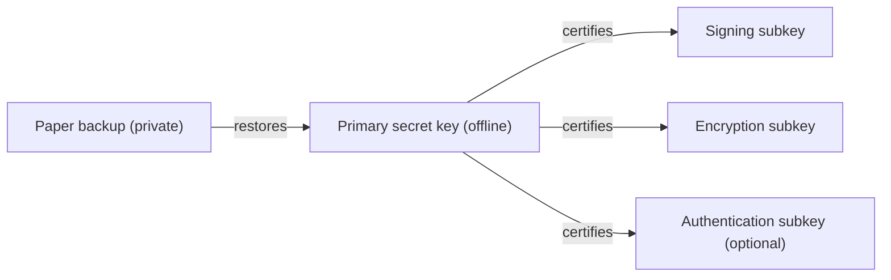

# Understand your PGP key and its paper backup

Alice wants to sign files and receive encrypted messages without keeping her
most important secret key on her everyday computer. This guide follows her
setup, explains what each part does, and shows what she can recover from paper.

The [README](README.md) has the commands for creating a key and its paper
backup. Here we build on that example, using `Alice <alice@example.org>` and
the exported `primary.asc`. You can read along without running the commands.
Packet layouts and signature types are collected in the
[technical appendix](#technical-appendix).

## 1. The setup we are building

Alice keeps her **primary key** offline and uses separate **subkeys** for
everyday work. The primary key authorizes those subkeys and connects them to
her identity. She brings it out when she needs to change that arrangement.



The subkeys have their own secrets. Alice can keep them on her daily computer
or a suitable hardware token. Losing a subkey does not require changing her
primary key, and a stolen subkey does not give someone the primary secret.

The public parts travel together in an **OpenPGP certificate**: the primary
public key, Alice's identities, public subkeys, and signatures connecting
them. Other people use this certificate to check her signatures and encrypt
messages to her. It contains no private keys.

GnuPG often calls the whole bundle a "key" or "public key". In this guide,
*certificate* means the public bundle, and *key* means an individual key pair.
Each pair has a public part to share and a secret part to protect.

## 2. Alice's primary key, identity, and fingerprint

Following the README, Alice generates 35 words and exports `primary.asc`.
The words let `gpg-keys` reconstruct her primary secret key. The export adds
her chosen identity and packages the result for OpenPGP tools.

She imports it into a dedicated GnuPG home on her offline machine:

```sh
mkdir -m 700 offline-gnupg
gpg --homedir offline-gnupg --import primary.asc
gpg --homedir offline-gnupg --list-secret-keys --with-subkey-fingerprint
```

The listing shows a primary key marked `[C]`, for **certification**. Its job
is to sign statements about identities and subkeys. The keys exported by
`gpg-keys` have only this capability; Alice will add subkeys for other jobs.

### Her name is a claim attached to the key

`Alice <alice@example.org>` is a **User ID**. The primary key signs a statement
connecting that text to itself. This is a **self-signature**: the key holder
is making a claim about their own identity.

It proves that the holder of the secret key chose that identity. Someone
checking it still needs a reason to believe the key belongs to the Alice
they know. We return to that question in section 5.

### Her fingerprint identifies the primary key

The **fingerprint** is calculated from the primary public key and its packet
metadata, including its creation time. Alice records it beside her words so
she can check that recovery produced the right key.

The creation time matters: the same secret with a different creation time
would produce a different fingerprint. That is why the words store both the
secret material and the original timestamp.

Her name, email address, expiry, and subkeys are attached through signatures.
Changing those does not change the primary fingerprint. The export passphrase
does not change it either; that passphrase protects the exported secret file.

Alice now has a recoverable primary key and a public identity claim. Next
she gives separate keys permission to do her everyday work.

## 3. Subkeys for everyday work

Alice creates a signing subkey and an encryption subkey in the offline
keyring. In every command below, replace `PRIMARY_FINGERPRINT` with her full
primary fingerprint:

```sh
gpg --homedir offline-gnupg --quick-add-key PRIMARY_FINGERPRINT ed25519 sign 1y
gpg --homedir offline-gnupg --quick-add-key PRIMARY_FINGERPRINT cv25519 encr 1y
```

GnuPG prompts for the passphrase as needed. It generates independent keys and
has the primary sign a **binding signature** for each one. The binding says
that this subkey belongs to Alice's certificate and specifies its role and
expiry. These commands give the subkeys one year of validity.

| Role | Alice uses it for | If the secret is lost |
| --- | --- | --- |
| Signing (`S`) | Files, mail, and Git commits | She can create a replacement for future signatures. |
| Encryption (`E`) | Decrypting messages sent to her | She needs a backup to read messages encrypted to that key. |
| Authentication (`A`, optional) | Logging in through tools such as SSH | She can replace it and update the systems that accept it. |

Separating the roles lets Alice replace or revoke one subkey without
replacing the others. For example, giving a recovery system access to an
encryption key need not give it the ability to sign as her.

**The paper backup does not contain these subkeys.** Alice must back up the
private encryption subkey before relying on it, including before moving it
to a smart card. A new primary-key export cannot recreate its secret.

For daily use, she transfers the needed secret subkeys and the public
certificate to her working environment, while keeping the primary secret
offline. GnuPG provides `--export-secret-subkeys` for this purpose; hardware
tokens have their own provisioning steps. See the
[GnuPG command reference](https://www.gnupg.org/documentation/manuals/gnupg/Operational-GPG-Commands.html)
for the export options. These exports contain secrets and need protection.

Some GnuPG setups use a primary marked `[SC]`, which can also sign data.
Alice's arrangement keeps everyday signing on a subkey so that it does not
require access to the primary secret.

## 4. What Alice's signature proves

Alice signs a file with her signing subkey. Bob receives the file, its
signature, and her public certificate. His software checks three things:

1. The data signature verifies with the signing subkey's public key.
2. The subkey has a valid binding to the primary, including the required
   confirmation from the signing subkey itself.
3. The keys and signatures meet the verifier's validity and security policy.

The software can then connect the signing subkey to Alice's certificate and
display her User ID. This is why a GnuPG message such as
`Good signature from "Alice <alice@example.org>"` can appear even though her
primary key never touched the file.

That result establishes a connection between the file and a key. Bob still
has to decide whether that key belongs to Alice. A valid signature also does
not tell him whether Alice personally reviewed the file or whether software
signed it automatically.

### Several email addresses still share one certificate

Alice can add a work email address as another User ID. Both identities then
share the same primary key, and anyone with the full certificate can see
their association.

A signature identifies the signing key. OpenPGP also allows a *Signer's
User ID* field to indicate a role, but it does not create independent keys
or control for each identity. See the
[specification's description of this field](https://www.rfc-editor.org/rfc/rfc9580.html#section-5.2.3.30).

If Alice runs a bot that signs automatically, a separate certificate gives
it a distinct identity and primary secret. She can then distinguish a bot's
output from work signed with her personal key. She may certify the bot's
identity with her primary to state that she operates it.

## 5. Trust, expiry, and revocation

Alice and Bob now need ways to establish whose keys they have and to learn
when those keys should stop being used.

### Connecting a key to a person

Bob can compare Alice's full fingerprint with her over a channel he already
trusts. Another person can also sign a statement connecting Alice's User ID
to her primary key. This is a **third-party certification**. Its usefulness
to Bob depends on how much he trusts that person's identity checks.

GnuPG distinguishes two ideas:

| Term | Question it answers |
| --- | --- |
| Validity | Do I accept that this User ID belongs to this key? |
| Ownertrust | How much do I trust this key holder to certify other people's identities? |

In GnuPG's web-of-trust model, certifications and Bob's trust in their
issuers let him establish validity through other people. The **web of trust**
is this network of certifications. A cryptographically good signature may
still come with an identity warning when GnuPG cannot establish that link.

Alice also tells GnuPG that her own key is hers. In her offline keyring:

```sh
echo "PRIMARY_FINGERPRINT:6:" | gpg --homedir offline-gnupg --import-ownertrust
```

The `6` assigns ultimate ownertrust in GnuPG's import format. She repeats this
in each new keyring she uses for her own key. Ownertrust is local state: it
does not travel inside the public certificate. It can be saved separately
with `--export-ownertrust`. The
[GnuPG manual](https://www.gnupg.org/documentation/manuals/gnupg/Operational-GPG-Commands.html)
documents both commands.

### Expiry sets a date for renewal

Alice's subkeys expire after the year she chose. Before then, she can use
her offline primary to extend their validity or authorize replacements, then
distribute the updated public certificate.

Expiry is recorded in signatures. Extending it changes the certificate's
metadata, while the key fingerprints stay the same. The same principle
applies to the primary: `gpg-keys export --expires 2y` sets a validity of two
years from the export time. Without `--expires`, its exports do not expire.

An expiry date helps limit continued use of a forgotten key. Someone holding
the primary secret can extend it, so it does not protect against theft of
that secret.

### Revocation announces that a key should no longer be used

If Alice loses control of a subkey, she uses her offline primary to revoke
it and distributes the updated certificate. If the primary itself is
compromised, she needs to revoke the whole certificate and establish a new
primary key.

She prepares a **revocation certificate** while she still has her primary:

```sh
gpg --homedir offline-gnupg --output revoke.asc --armor \
  --gen-revoke PRIMARY_FINGERPRINT
```

This creates a signed revocation for later use; it does not publish it or
immediately revoke her working keyring. She keeps it separately so that she
can still revoke the key if the primary and its backup are lost. Anyone
who obtains it can distribute the revocation, so it needs protection too.
The [GnuPG key-management manual](https://www.gnupg.org/documentation/manuals/gnupg/OpenPGP-Key-Management.html)
describes how to apply and distribute it.

Retiring or expiring a signing subkey does not by itself erase the value of
older signatures. A compromise revocation is different: past signatures are
suspect because someone with the stolen secret could forge a signing date.
The verifier's policy and the revocation reason matter. See
[OpenPGP's revocation reasons](https://www.rfc-editor.org/rfc/rfc9580.html#section-5.2.3.31).

Revoking a User ID similarly announces that the identity is no longer in
use. It does not remove that identity from copies already distributed.

## 6. Backing up and recovering the setup

Alice's paper words restore the primary secret and its creation time.
Keeping her whole setup recoverable takes a few separate backups:

| What Alice keeps | What it preserves |
| --- | --- |
| Paper words | The primary secret and creation time. Anyone with the words can recover it. |
| Public certificate | Identities, certifications, subkey bindings, expiry updates, and revocations. |
| Private subkeys | Access to the existing subkeys, especially decryption of old messages. |
| Revocation certificate | A way to revoke the primary if she can no longer use it. |
| Local GnuPG state | Ownertrust and any configuration she wants to retain. |

After changing identities, subkeys, expiry, or revocations, she saves a fresh
public certificate from the offline keyring. For the first copy:

```sh
gpg --homedir offline-gnupg --output alice-public.asc --armor \
  --export PRIMARY_FINGERPRINT
```

On later exports, she uses a new filename or deliberately replaces the old
backup. The public certificate is shareable; the paper and private-key
backups must remain confidential.

### Recovering after losing the offline keyring

Alice practices recovery before she depends on the backup:

1. She types the words from paper into a file and follows the
   [README's recovery example](README.md#recover-from-paper) to export
   `recovered-primary.asc`, using a User ID she intends to certify now.
   She checks that the identity recorded on paper is still appropriate.
2. She compares the printed fingerprint with the paper and her saved public
   certificate. They must identify the same primary key.
3. She imports the recovered primary and the saved public certificate into
   a fresh offline GnuPG home.
4. She restores any separately backed-up private subkeys and ownertrust,
   then checks the resulting identities, capabilities, expiry, revocations,
   and subkeys before use.

The import in step 3 is:

```sh
mkdir -m 700 recovered-gnupg
gpg --homedir recovered-gnupg --import recovered-primary.asc alice-public.asc
```

Recovery keeps the original creation time in the primary-key packet and
creates a fresh self-signature dated at export time. This certifies the
supplied User ID anew. Merging the saved public certificate retains its
packets, including revocations and subkey bindings, but the fresh
certification can reactivate a retired User ID or replace earlier capability
and expiry settings. It does not undo a compromised-primary-key revocation.

**If Alice wants the fresh certificate to expire, she passes `--expires`
again during recovery.** If the new self-signature becomes active after
merging, its settings apply, including no expiry when that option is omitted.
It is not guaranteed to take precedence: signatures made in the same second,
a clock that has moved backwards, or existing future-dated signatures can
affect selection. Alice checks the merged certificate and uses GnuPG's
key-management commands to make deliberate changes to its settings.

With her primary restored, Alice can authorize new subkeys. To decrypt old
messages, she still needs the original private encryption subkey. Its public
binding and her recovered primary secret cannot reconstruct it.

For the backup format and independent recovery instructions, see
[FORMAT.md](FORMAT.md). For a document to keep with the handwritten words,
see the [printable booklet](paper-backup/README.md).

## Technical appendix

The details below explain how the relationships above are represented.
They are optional for following Alice's setup. The packet and fingerprint
examples describe the version 4 keys produced by this project.

### Secret handling

The application wipes its secret buffers and Argon2 workspace when dropped.
It allocates input/output buffers before filling them to avoid leaving
unwiped copies when those buffers grow. This is best-effort cleanup:
temporary stack or library copies, I/O buffers, terminal scrollback, swap,
and process snapshots can retain secrets. Alice still protects her files
and the machine on which she generates or recovers keys.

### The primary-key packet and fingerprint

The primary public-key packet contains a version, creation time, algorithm,
and public key material. For `gpg-keys`, these are version 4, the backed-up
timestamp, algorithm 22 (legacy OpenPGP Ed25519), and the curve identifier
plus encoded Ed25519 public point.

```text
fingerprint = SHA-1(0x99 || two-byte body length || public-key packet body)
```

Names, expiry, and capabilities are not fields in that packet. For the
certificates this tool exports, they are represented by User IDs and their
self-signatures. The primary secret is a 32-byte native Ed25519 seed;
compact backups derive it from the stored 20-byte entropy. The precise
derivation and encoding are specified in [FORMAT.md](FORMAT.md).

### Who signs what

| Signature | Type | Signer | What it connects or affects |
| --- | --- | --- | --- |
| Data signature | `0x00` / `0x01` | A signing key | Binary data / canonical text |
| User ID certification | `0x10`–`0x13` | The primary itself or another certifier | Primary key and User ID |
| Subkey binding | `0x18` | Primary key | Primary key and subkey |
| Back-signature | `0x19` | Signing subkey | The same primary key and subkey |
| Key revocation | `0x20` | Primary key in Alice's setup | Primary key |
| Subkey revocation | `0x28` | Primary key in Alice's setup | Primary key and subkey |
| Certification revocation | `0x30` | The certifier | Its earlier certification |

`gpg-keys` creates a type `0x13` self-certification. It carries the certify
flag, optional primary expiry, algorithm preferences, and a primary-User-ID
marker. Subkey bindings carry the subkey's capabilities and expiry instead.

For version 4 keys, the signed inputs have these shapes:

```text
User ID certification:
    0x99 || two-byte primary body length || primary body
    0xB4 || four-byte User ID length || User ID
    signature metadata and trailer

Subkey binding and back-signature:
    0x99 || two-byte primary body length || primary body
    0x99 || two-byte subkey body length || subkey body
    signature metadata and trailer
```

These are structural sketches, not a complete signing implementation.

### Why a signing subkey signs back

A primary signs the binding to a subkey. A signing subkey also signs back,
confirming the association with that primary. Its back-signature is embedded
in the primary's binding signature. This prevents another primary holder
from simply attaching someone else's public signing subkey and claiming its
signatures. GnuPG explains the mechanism in its
[cross-certification guide](https://www.gnupg.org/faq/subkey-cross-certify.html).

A holder of the necessary secrets can deliberately bind a subkey under a
different primary. Its fingerprint stays the same, but the new primary must
make a new binding, and a signing subkey must make a new back-signature.
This is an advanced migration operation; it is not needed for paper recovery.

### Updating metadata and delegating trust

For multiple self-signatures on the same component, the newest valid one
determines its metadata. This is how expiry and preferences can change
without changing the key. Do not depend on ordering between signatures made
in the same second. See the specification's
[notes on self-signatures](https://www.rfc-editor.org/rfc/rfc9580.html#section-5.2.3.10).

A third-party certification can also carry a **trust signature**, delegating
authority to certify other identities within a stated scope and depth.
This supports arrangements such as organizational certifiers; Alice does not
need it for the personal setup described here.
